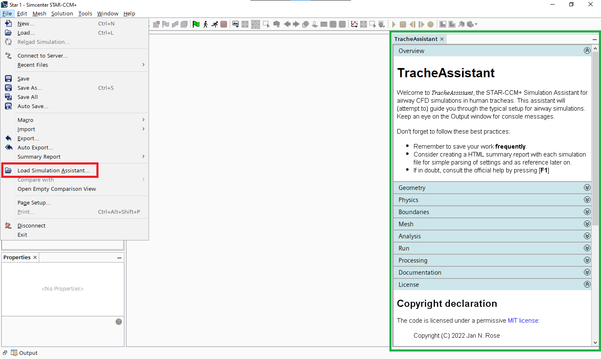

# TracheAssistant

STAR-CCM+ Simulation Assistant for airway CFD simulations in human tracheas.

## What is this?

From the STAR-CCM+ user guide:
> A Simulation Assistant provides a visual workflow within the Simcenter STAR-CCM+ user interface (UI).

## Getting started

I am using Apache NetBeans IDE 12.6 for development. The [nbproject](./nbproject/) directory in this repository contains all configuration files such that the project can be loaded and built (almost) right away.

A recent JDK needs to be installed. I am using OpenJDK 17.0.2. The project is configured to build with JDK 11 compatibility (required for STAR-CCM+).

Within NetBeans, the STAR-CCM+ development class and javadoc paths need to be configured. The setup assumes the library name `STAR-CCM+ 2021.2.1 (16.04.012) - JDK`. This can be changed inside [nbproject/project.properties](./nbproject/project.properties) by editing the `javac.classpath` variable.

### Build on macOS without an IDE

The repository includes a direct `javac` build path so the assistant can be verified without NetBeans or IntelliJ.

Requirements:

- JDK 11 or newer. The source is compiled with `--release 11` for STAR-CCM+ compatibility. JDK 17 is a good default because this project has already been used with OpenJDK 17.
- STAR-CCM+ Java library jars on the compile classpath. These are local install files and are not committed to the repository.

Install a JDK on macOS:

```sh
brew install --cask temurin@17
/usr/libexec/java_home -V
javac -version
```

If `javac` is still not found, add the JDK to your shell profile:

```sh
export JAVA_HOME=$(/usr/libexec/java_home -v 17)
export PATH="$JAVA_HOME/bin:$PATH"
```

After STAR-CCM+ is installed, generate the local classpath file:

```sh
./scripts/generate-starccm-classpath.sh "/Applications/Siemens/16.04.012/STAR-CCM+16.04.012"
```

Then check the environment and build:

```sh
./scripts/build.sh --check
./scripts/build.sh
```

The output jar is written to [dist/TracheAssistant.jar](./dist/TracheAssistant.jar). To avoid creating a classpath file, provide the classpath directly:

```sh
STARCCM_CLASSPATH="/path/to/a.jar:/path/to/b.jar" ./scripts/build.sh
```

Instead of building the assistant from source, pre-built versions can be downloaded from [GitHub Releases](https://github.com/janniklasrose/TracheAssistant/releases/).

## Loading the simulation assistant



In an active STAR-CCM+ session, click on `File > Load Simulation Assistant...` (red) and `Open` the file `TracheAssistant.jar`. This places the simulation assistant on the right of the window (green).
